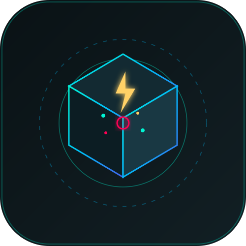

<div align="center">



# Minecraft Automation Engine
### Ultra-Low-Overhead (<15MB RAM) Out-of-Process Automation with Packet Sniffing & Hardware HID

[](LICENSE)
[](#)
[](#)
[](#)

<p align="center">
  <b>An external, ultra-low-overhead Minecraft automation engine that intercepts network packets via a local sniffer proxy, prioritizes macros with durability safeguards, and injects inputs via hardware USB-HID emulation.</b>
</p>

</div>

---

An ultra-low-overhead, out-of-process automation engine for Minecraft. This tool runs externally to the game client, intercepting network packet communication via a local sniffer proxy, scheduling macros with a priority-gated scheduler, and executing inputs via hardware USB-HID emulation (or Linux `uinput` kernel fallbacks).

Designed to run strictly under a **15MB RAM footprint** on resource-constrained hosts.

---

## Key Features

1. **Protocol Sniffer Proxy (`src/network_proxy.py`)**:
   - Built on `Quarry` and Twisted's asyncio reactor.
   - Intercepts clientbound `Set Container Slot` and `Held Item Change` packets to track tool durability and server slot confirmations.
   - Intercepts player positioning packets and suspends execution if position drift exceeds $0.5$ blocks (preventing lag-induced desync flags).

2. **Priority Scheduler (`src/scheduler.py`)**:
   - Cooperative, priority-preemptive `asyncio` task queue.
   - Enforces slot-restricted allocations via python `__slots__` to eliminate dynamic `__dict__` overhead.
   - Protects macros using a `SwingInterruptionMatrix` that invalidates swings upon tool breaks or pending slot changes.

3. **Input Emulation Bridge (`src/input_bridge.py`)**:
   - Sends mouse/keyboard delta coordinates over a Serial connection to external microcontrollers (e.g., RP2040/ESP32 running a USB-HID stack).
   - Automatically falls back to Linux `/dev/uinput` virtual input nodes if physical hardware is disconnected.
   - Features a positive-bounded **Gaussian-Weibull mixture model** for micro-jitter delay injection to mimic human motor response and bypass Kolmogorov-Smirnov detection.

4. **Telemetry Control Dashboard (`src/main.py`)**:
   - Features a custom dark-mode dashboard built on `Dear PyGui`.
   - Runs cooperatively inside the asyncio thread event loop.
   - Caches PrismarineJS items schemas dynamically to match item IDs to max tool durability attributes.

---

## Project Structure

```
autoclicker/
├── config/
│   └── settings.json          # Server & timing configurations
├── data/                      # Cached PrismarineJS schema files
├── docs/                      # Onboarding, sniffing, and architecture details
├── src/
│   ├── __init__.py
│   ├── input_bridge.py        # Serial and uinput fallbacks
│   ├── main.py                # Main entry point & DPG telemetry UI
│   ├── network_proxy.py       # Quarry TCP proxy bridge
│   └── scheduler.py           # Preemptive asyncio scheduler
├── tests/
│   ├── __init__.py
│   └── test_scheduler.py      # Core unit tests
├── .gitignore
├── requirements.txt           # Project dependencies
└── README.md
```

---

## Installation & Setup

### Prerequisites

Ensure you have Python 3.10+ installed.

1. **Install Dependencies**:
   ```bash
   pip install -r requirements.txt
   ```
   *Note: For the uinput fallback, ensure the `evdev` package is installed and your user has write permissions to `/dev/uinput` (e.g. member of the `uinput` or `input` group, or run with elevated permissions).*

2. **Hardware Microcontroller setup (Optional)**:
   Connect an RP2040/ESP32 microcontroller flashed with a standard serial-to-HID translation sketch to `/dev/ttyACM0` or configure the port in `config/settings.json`.

---

## Running the Engine

1. **Configure Parameters**:
   Edit `config/settings.json` to configure target Minecraft version, local proxy ports, and timing jitter definitions:
   ```json
   {
     "TARGET_VERSION": "1.20.1",
     "PROXY_PORT": 25565,
     "JITTER_MU": 18.0,
     "JITTER_SIGMA": 6.0,
     "OUTLIER_RATE": 0.02
   }
   ```

2. **Start the Engine**:
   ```bash
   python3 src/main.py
   ```
   This will start the local Quarry proxy on `127.0.0.1:25565` and launch the Dear PyGui telemetry window.

3. **Connect Your Game Client**:
   Launch Minecraft, navigate to Multiplayer, and add a server pointing to `127.0.0.1:25565`. The proxy will forward connection handshakes and packet streams to the target server while sniffing active slot statistics.

---

## Running Unit Tests

Run the test suite to verify scheduler preemption loops and slot constraint validations:

```bash
python3 -m unittest discover -s tests
```
